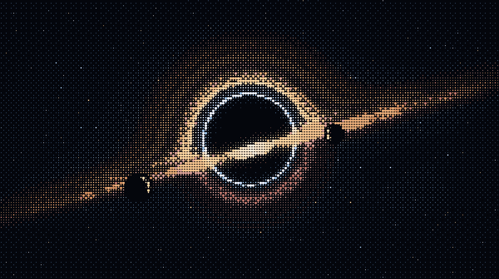
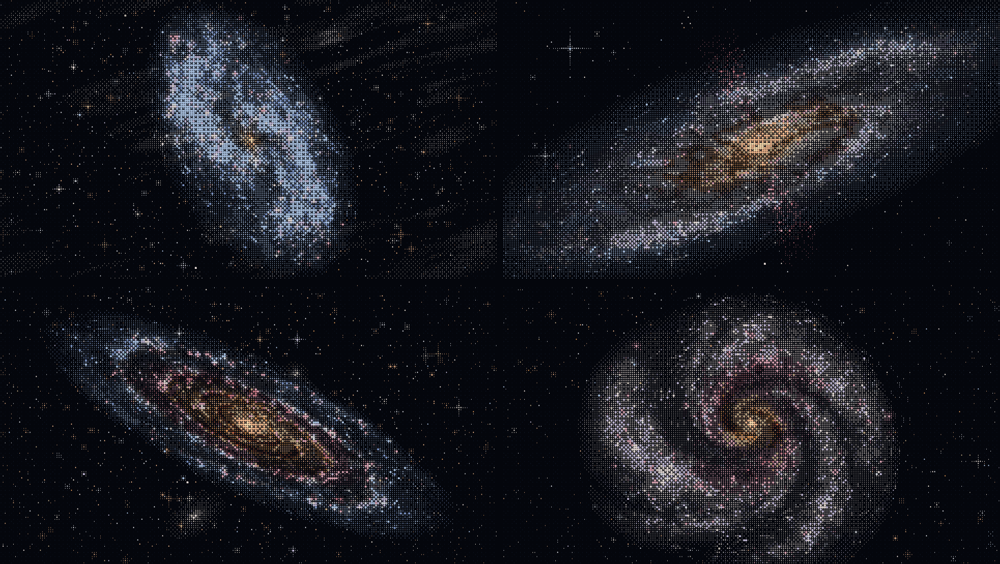
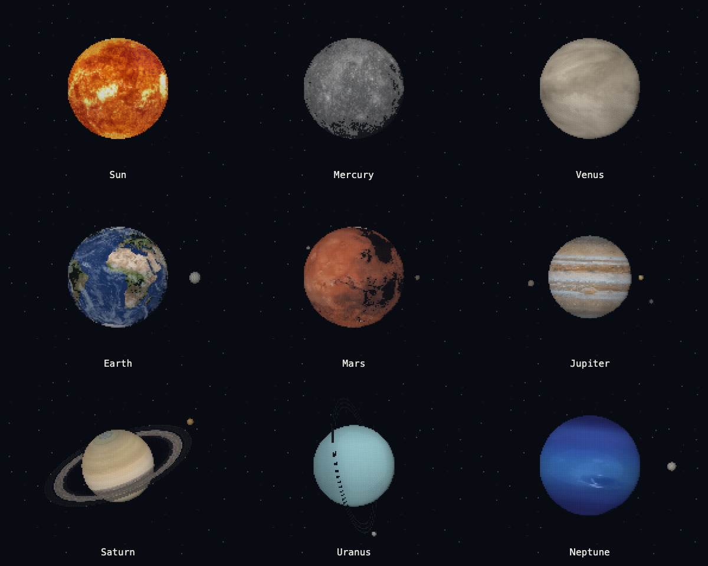

<div align="center">

# Astro ASCII

**A small universe, drawn in characters.**

Animated black holes and photo-based astronomy studies. Open a page, watch the light move, and inspect how it is made.

[](https://github.com/kenny2077/astro-ascii/actions/workflows/ci.yml)
[](LICENSE)

[Live preview](https://kenny2077.github.io/astro-ascii/) · [Collection](#collection) · [Quick start](#quick-start) · [How it works](docs/rendering.md) · [Contributing](CONTRIBUTING.md) · [Credits](docs/credits.md)



</div>

## Collection

| Work | Medium | What moves | Open locally |
| --- | --- | --- | --- |
| **Galaxies** | Four procedural spirals: Triangulum, Sculptor, Andromeda, Pinwheel | Turning discs, orbiting stars, glittering nebulae, a starburst wind, a crimson ring wave | [Live galaxies](https://kenny2077.github.io/astro-ascii/?piece=galaxies) |
| **Solar system** | Nine rotating worlds: Sun + eight planets | Steady-lit rotation, independent clouds, rings and selected orbiting moons | [Live solar system](https://kenny2077.github.io/astro-ascii/?piece=solar) |
| **Black hole** | Procedural Unicode dot art | Accretion-disk texture and starlight | [Artwork](art/black-hole/index.html) |
| **Astro photo study** | Photo-derived dot art, strict ASCII, or pixel rendering | Small brightness changes at fixed source positions | [Photo renderer](art/photo-study/index.html) |

Open the [preview website](https://kenny2077.github.io/astro-ascii/) to play the collection without downloading. GitHub repository file views only show the source and static/GIF previews. The website publishes from `main` using GitHub Pages.



The galaxies viewer holds four models, each built from its galaxy's real shape: tilt, arm pitch, bulge, dust lanes and star-forming knots. Nothing is traced from a photograph. Each is styled after a ZWO Astronomy Photographer of the Year 2026 image, credited in [credits and provenance](docs/credits.md). Each disc turns once every two minutes while its bulge holds still. Stars orbit through the arms on a flat rotation curve, and each galaxy has one motion of its own. Every motion closes on the same two-minute loop. Choose a galaxy with the thumbnails, the arrow keys or `?galaxy=pinwheel`.



The solar-system viewer uses slow continuous rotation and steady lighting. Earth’s clouds move independently of its surface. Selected natural moons orbit their planets, with foreground/background occlusion; Saturn and Uranus show distinct ring systems. Mercury and Venus have no moons. Rotation periods, satellite sizes and distances are compressed for a readable art scene. Use pause to inspect each body. [Rendering details](docs/rendering.md#solar-system) and [reference sources](docs/planet-photo-references.md) describe the approximations.

The collection is at an early stage. These are artistic interpretations, not scientific simulations or a published SDK. The default scenes style uses Unicode `· • ●`; the photo study also offers printable ASCII characters.

## Quick start

1. Visit the [website](https://kenny2077.github.io/astro-ascii/), or download **Code → Download ZIP** / clone for offline use.
2. Open `art/galaxies/index.html` or `art/black-hole/index.html` in a modern browser. No installation or build is needed.
3. Open `art/photo-study/index.html` and choose a local astronomy photograph to compare ASCII and pixel treatments. The image stays in your browser.

The photo study includes pause/play, motion intensity, character selection, side-by-side comparison, and an original-image view. Every artwork respects reduced-motion preferences.

## Design principles

- **Recognizable subjects.** Preserve silhouette, negative space, and the source image's color relationships.
- **Quiet motion.** Prefer small, periodic light changes to arbitrary distortion.
- **Inspect the work.** Keep rendering code readable; the solar-system viewer includes a separate local texture pack.
- **Credit the source.** Record photograph rights separately from the software license.

The dot-halftone approach is inspired by [bas3line/ascii](https://github.com/bas3line/ascii). Its MIT notice is retained in [licenses](licenses/bas3line-MIT.txt).

## Development

Use Node.js 22 or newer. There are no runtime npm dependencies.

```sh
npm test
```

Checks cover inline JavaScript syntax, local Markdown links, accidentally embedded images/private paths, and, for the black hole, the galaxies and the solar system, frame bounds, motion, and loop closure. CI runs the same command. Browser visual review remains a separate check.

For GIF export, see [the export guide](docs/exporting.md). For new works, see [CONTRIBUTING.md](CONTRIBUTING.md).

## Roadmap

- Add nebula works with documented image permissions.
- Confirm the credit for the Pinwheel reference photograph.
- Expand browser checks for photo import, pause, resize, and reduced motion.
- Add more downloadable previews after visual review.

## License and image rights

Project code is MIT licensed. Third-party code retains its original notices. Solar-system maps and adapted previews use Solar System Scope / INOVE assets under **CC BY 4.0**; see [texture attribution](art/solar-system/TEXTURES.md). Source photographs are not automatically covered by the code license. The galaxies are procedural models; their reference photographs are not included or sampled. The public repository does **not** include *The Quiet Predator*, its derived previews, or the local Walensee study because redistribution permission has not been established. You can use a local copy with the photo renderer. See [credits and provenance](docs/credits.md).
